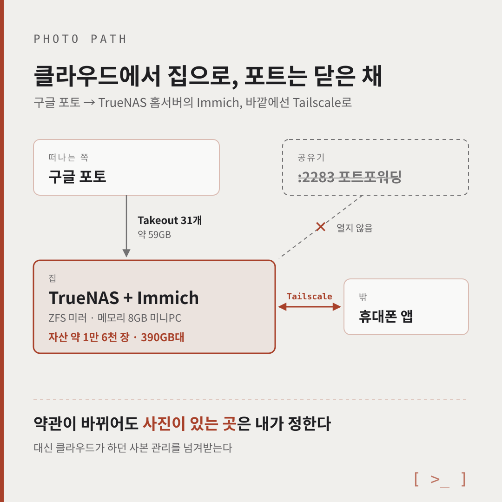
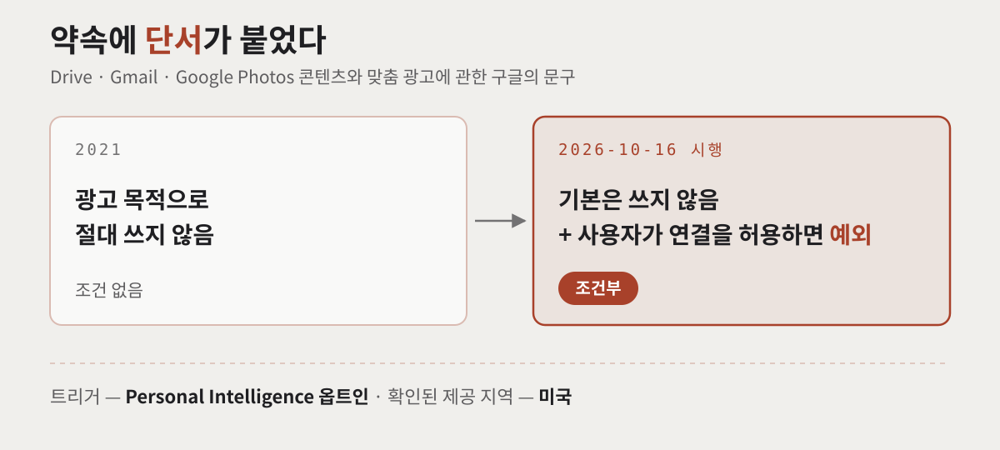
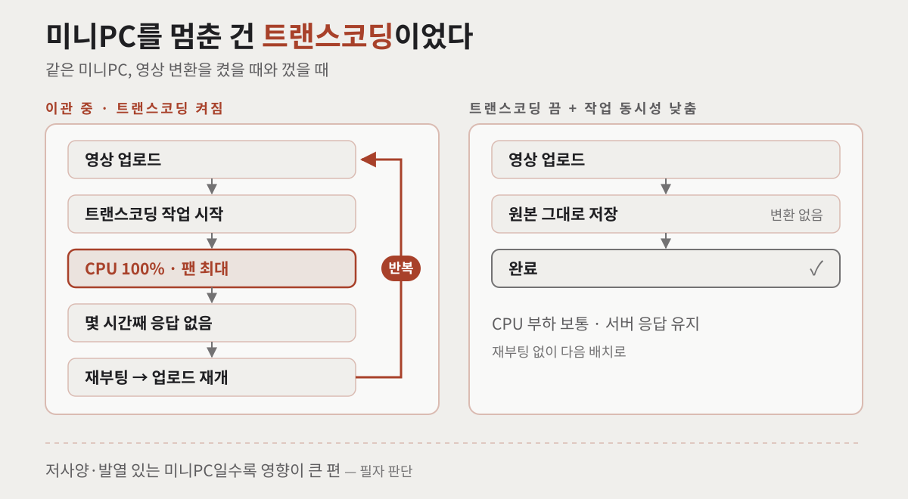
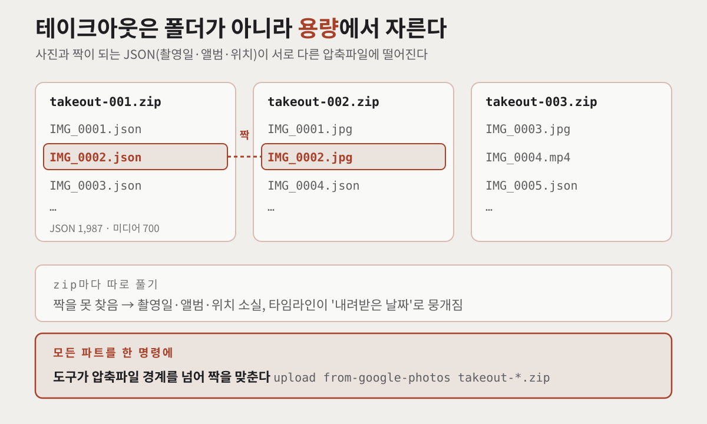
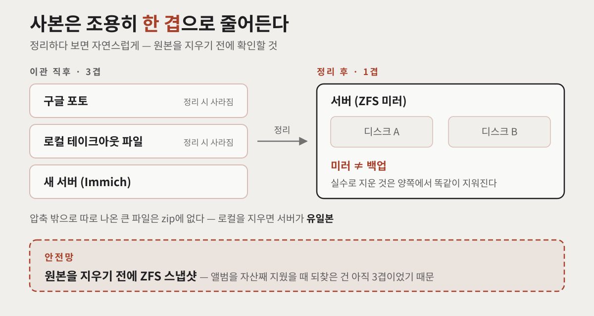
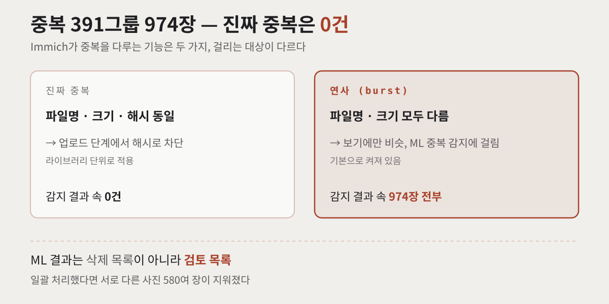

구글이 10월 16일부터 시행한 개인정보처리방침에서, 사진 이야기가 한 줄 바뀌었습니다. "Drive·Gmail·Google Photos 콘텐츠로 맞춤 광고를 하지 않는다"는 약속에 **"사용자가 허용한 경우는 예외"**라는 단서가 붙었습니다. 당장 내 사진이 광고에 쓰인다는 뜻은 아닙니다. 다만 '조건 없는 약속'이 '조건이 붙을 수 있는 약속'으로 바뀐 것은 맞습니다.

저는 이 뉴스보다 두 달 먼저, 8월에 **구글 포토 사진을 집에 있는 홈서버의 Immich로** 옮겼습니다. 계기는 정책이 아니라 저장용량 요금이었습니다. 이 글을 지금 쓰는 이유는 이번 개정으로 '데이터가 어디에 있느냐'가 다시 질문이 됐기 때문입니다.

구글 포토를 떠나야 한다는 글은 아닙니다. **떠난다면 어떤 조건이 갖춰져야 하는지**, 직접 옮기며 확인한 것을 정리했습니다. 자가호스팅을 고민 중이라면 사양과 체크리스트를, 이미 옮기는 중이라면 '잃기 쉬운 것 세 가지'를 먼저 보셔도 됩니다.



## 구글 개인정보처리방침, 정확히 무엇이 바뀌었나?

정책 원문부터 보겠습니다. 2026년 10월 16일 시행본은 이렇게 적고 있습니다([Google 개인정보처리방침](https://policies.google.com/privacy)).

> "We don't show you personalized ads based on your content from Drive, Gmail, or Google Photos" — 단, 사용자가 "choose to make data from these services available to other Google services that support personalized ads" 한 경우는 예외.

즉, **기본값은 여전히 '맞춤 광고에 쓰지 않음'**입니다. 예외가 걸리는 쪽은 **Personal Intelligence**처럼 Gmail·Google Photos를 검색(AI Mode)이나 Gemini에 연결하는 옵트인(opt-in) 기능을 켠 사용자입니다. 연결은 선택 사항이고 명시적 동의가 필요합니다([Help Net Security](https://helpnetsecurity.com/2026/01/26/google-ai-mode-personal-intelligence/)). 확인된 제공 지역은 미국이고, 한국 제공 여부와 일정은 확인하지 못했습니다.

그래도 짚어둘 문장이 있습니다. 구글 지원 문서 설명을 인용한 보도에 따르면, 광고가 Gmail이나 Photos 라이브러리에 **"직접(directly)"** 기반하지는 않지만, 검색은 거기서 만든 **요약·발췌·추론(summaries, excerpts, inferences)**을 참조할 수 있습니다([Techlicious](https://www.techlicious.com/blog/google-gmail-photos-insights-ads/)). 2021년 보도 당시 구글의 문구는 "Gmail, Photos, Drive에 저장한 콘텐츠를 광고 목적으로 절대 쓰지 않는다"였습니다([9to5Google, 2021](https://9to5google.com/2021/05/19/google-protect-privacy/)).

정리하면 바뀐 것은 지금 당장의 사용 방식이 아니라 **약속의 형태**입니다. 그리고 약속은 서비스 제공자가 언제든 다시 고칠 수 있습니다. 데이터가 내 디스크에 있으면 그 약속에 기댈 필요가 없습니다. 제가 이 개정에서 읽은 건 이것 하나입니다.

> **유의사항** — 옮길 생각이 없다면 연결을 끄는 것으로 충분합니다. Google 계정 → 데이터 및 개인정보 보호 → **Search Services Personalization**에서 Connected Content Apps의 Google Photos·Workspace 연결을 해제하고, Personalized Recommendations도 끌 수 있습니다. 연결을 끊어도 이미 저장된 기록은 남으므로 activity.google.com에서 따로 지워야 합니다([Android Authority](https://www.androidauthority.com/google-personal-intelligence-privacy-3727111/), [Techlicious](https://www.techlicious.com/blog/google-gmail-photos-insights-ads/)).



## 어떤 구성으로 옮겼나 — TrueNAS + Immich + Tailscale

구성은 단순합니다.

- **TrueNAS 홈서버** — ZFS 기반 미니PC, 메모리 8GB. 파일 동기화 서비스와 리버스 프록시가 이미 돌고 있었습니다.
- **Immich** — 자가호스팅 사진 서버. 얼굴 인식, 자연어 검색, 모바일 자동 백업, 앨범·공유까지 구글 포토에서 쓰던 기능 대부분이 들어 있습니다.
- **Tailscale** — 외부 접근용 VPN. 공유기 포트를 하나도 열지 않습니다.

TrueNAS와 Tailscale 기본 설정은 [Syncthing으로 여러 PC 동기화 — TrueNAS 허브 + Tailscale](/posts/syncthing-truenas-tailscale/)에서 다뤘으니 여기서는 생략합니다.

TrueNAS의 Immich 앱은 **커뮤니티 트레인(community train) 앱**입니다. Immich 팀이 공식 지원하는 설치 방식이 아니고, TrueNAS Community Edition 24.10.2.2 이상이 필요합니다([Immich Docs — TrueNAS](https://docs.immich.app/install/truenas)). 앱 문제는 TrueNAS 쪽 저장소로 가야 한다는 점을 알고 시작하면 덜 헤맵니다.

결과부터 말하면 자산 **약 1만 6천 장, 390GB대**가 옮겨졌습니다. 구글 테이크아웃(Google Takeout) 압축파일은 **31개, 약 59GB**였고, 드라이브에 폴더로 정리해 둔 사진도 함께 올렸습니다. 서버 응답은 한 자릿수 ms입니다.

## 자가호스팅 사진 서버, 어디까지 되고 어디서 밀릴까?

솔직하게 갈라 보겠습니다. 아래는 제 판정입니다.

| 항목 | Immich 자가호스팅 | 판정 |
|---|---|---|
| 타임라인·앨범·공유 | 동등 | 됨 |
| 얼굴 인식·자연어 검색 | 동등. 단, **첫 인덱싱에 시간과 메모리**가 듭니다 | 됨(단서) |
| 모바일 자동 백업 | 동등 | 됨 |
| 원본 해상도 보관 | **우위** — 디스크가 허용하는 한 원본 그대로 | 됨 |
| 영상 재생 호환성 | 트랜스코딩을 끄면 코덱에 따라 브라우저 재생이 안 될 수 있음 | 주의 |
| 외부 접근 | 직접 구성(VPN·터널·도메인) | 주의 |
| **내구성** | **직접 책임집니다** | 핵심 비용 |

옮기고 나서 가장 크게 느낀 건 원본 해상도였습니다. 클라우드에서는 용량을 아끼려면 압축 저장을 고민하게 되는데, 집 디스크에서는 그 고민이 없습니다.

앞의 여섯 줄은 설정 문제라 시간을 쓰면 풀립니다. **마지막 줄은 성격이 다릅니다.** 클라우드는 사본 관리를 대신 해주고 있었고, 그걸 넘겨받는 것이 자가호스팅의 진짜 비용입니다. 이 글 뒤쪽의 체크리스트 대부분이 이 한 줄에서 나옵니다.

## 서버를 반복해서 멈춘 건 영상 트랜스코딩이었습니다

이관 중에 **CPU가 100%에 붙고, 팬이 최대로 돌고, 서버 전체가 몇 시간씩 응답하지 않는 일**이 반복됐습니다. 기다려도 스스로 돌아오지 않아서 재부팅하고, 업로드를 이어 가고, 다시 멈추는 일을 여러 번 겪었습니다.

원인은 **영상 트랜스코딩(Transcoding)**이었습니다. 영상이 올라오면 Immich가 브라우저 재생용 변환본을 만드는데, 이 작업이 CPU를 끝까지 씁니다. 공식 FAQ도 초기 백업이 작업이 가장 많이 몰리는 구간이고, 그중 가장 CPU를 많이 쓰는 작업이 트랜스코딩과 머신러닝(ML) 작업이라고 설명합니다([Immich FAQ — Can I lower CPU and RAM usage?](https://docs.immich.app/FAQ/#can-i-lower-cpu-and-ram-usage)). 제 라이브러리는 영상이 파일 수로는 20%인데 **용량으로는 90%**였습니다.

해결은 두 가지였습니다.

1. **트랜스코딩을 껐습니다.** 변환본 없이 원본을 그대로 서빙합니다. 재생에서 크게 불편한 점은 없었습니다.
2. **작업 동시성(job concurrency)을 낮췄습니다.** Immich 설정의 작업(Jobs) 항목에서 동시에 도는 작업 수를 줄였습니다. FAQ도 CPU 부하를 줄이는 방법으로 동시성을 1로 낮추고, 트랜스코딩 스레드 수를 1–2로 두는 것을 안내합니다.

이렇게 바꾼 뒤로는 나머지가 문제없이 올라갔고, 이관을 끝까지 마칠 수 있었습니다. 다만 서버가 성능이 낮고 발열이 큰 미니PC라는 점도 영향을 줬을 거라고 봅니다. 같은 작업이라도 냉각과 여유가 있는 기계였다면 덜 버거웠을 겁니다.



### 메모리도 같이 빠듯했습니다

멈춘 직접 원인은 트랜스코딩이었지만, 메모리 8GB도 넉넉하지 않았습니다. 같은 서버에서 ZFS 캐시와 다른 서비스가 메모리를 나눠 쓰고, 대량 임포트 때는 얼굴 인식·검색 인덱싱까지 한꺼번에 돌기 때문입니다.

Immich 공식 요구사항은 **RAM 최소 6GB, 권장 8GB**, CPU는 권장 4코어입니다([Immich Docs — Requirements](https://docs.immich.app/install/requirements)). TrueNAS 앱 가이드도 ML을 켜면 8000MB 초과를 권장합니다([Immich Docs — TrueNAS](https://docs.immich.app/install/truenas)). 제 권장은 그보다 높은데, 공식 수치는 Immich 단독 기준이고 제 환경은 다른 서비스와 대량 임포트가 겹쳤기 때문입니다.

| | 최소 | 권장(제 환경 기준) |
|---|---|---|
| **메모리** | 8GB(ML 끄고, 배치 쪼개서) | **16GB 이상.** 다른 서비스와 같이 쓰면 32GB |
| **CPU** | 4코어 | 트랜스코딩이 CPU를 가장 많이 씁니다. 저전력 미니PC라면 트랜스코딩을 끄거나 동시성을 낮추고, 냉각도 챙겨야 합니다 |
| 디스크 | 원본 × 1.3 | 공식 문서는 썸네일·변환본으로 10–20% 증가를 안내합니다 |
| 이중화 | 미러 이상 | 단일 디스크는 권하지 않습니다 |

**8GB로 끝까지 가긴 했지만 권장하지 않습니다.** ML을 끄면 8GB로도 돌지만, 얼굴 인식과 자연어 검색이 자가호스팅을 쓸 만하게 만드는 기능이라 그걸 끄면 옮긴 의미가 절반쯤 사라집니다. 컨테이너가 코드 137로 죽는다면 메모리 부족 신호이고, 얼굴 인식 모델을 더 가벼운 `buffalo_s`로 바꾸는 방법도 있습니다(정확도는 낮아집니다)([Immich FAQ](https://docs.immich.app/FAQ/)).

## Tailscale로 밖에서 접속할 때 알아둘 것은?

Immich 공식 원격 접근 가이드는 **기본 포트 2283을 인터넷에 직접 포워딩하지 말라**고 합니다. HTTP로 노출되기 때문입니다. 리버스 프록시로 공개하는 방식도 웹과 API가 그대로 드러납니다. 반면 Tailscale은 NAT 뒤에서도 터널을 만들고 **공유기 포트를 열 필요가 없습니다**([Immich Docs — Remote Access](https://docs.immich.app/guides/remote-access)). 제가 공개 노출 없이 Tailscale만 쓴 이유가 이것입니다.

저는 모바일 앱 서버 주소를 Tailscale 주소 하나(예: `http://example-host:2283`)로만 두고 집 안팎 구분 없이 씁니다. 집 Wi-Fi에서도, 밖에서도 같은 주소로 닿습니다. 몇 가지 함정은 있습니다.

- **Tailscale HTTPS 인증서를 쓰면 기계 이름이 공개됩니다.** `*.ts.net` 인증서는 공개 인증서 투명성(Certificate Transparency) 로그에 기록되고, Tailscale 문서도 기계 이름에 민감한 정보가 있으면 HTTPS 기능을 켜지 말라고 안내합니다([Tailscale KB — Enabling HTTPS](https://tailscale.com/kb/1153/enabling-https)). 서버 이름을 `example-host`처럼 무난하게 바꾼 뒤 켜는 편이 낫습니다.
- **iOS 백그라운드 백업은 OS가 결정합니다.** 앱이 통제할 수 없으니 백그라운드 앱 새로고침을 켜고 저전력 모드를 끄는 것이 권장되고, 첫 대량 업로드는 **앱을 열어둔 채(포그라운드)** 하라고 문서가 안내합니다([Immich Docs — Automatic Backup](https://docs.immich.app/features/automatic-backup)).
- **집 Wi-Fi에서 로컬 주소로 자동 전환**하는 기능도 있지만, Wi-Fi 이름을 읽기 위해 위치 권한(백그라운드는 '항상 허용')이 필요합니다([Linuxiac — Immich 1.122](https://linuxiac.com/immich-1-122-brings-hdr-video-support-in-the-mobile-app/)).

## 구글 포토 이관 체크리스트 — 전·중·후

### 이관 전

- [ ] **압축파일 무결성 검사**(`unzip -t`) — 다 올리고 나서 깨진 걸 알면 늦습니다
- [ ] **압축파일을 하나씩 따로 풀지 않습니다** ← 가장 중요합니다(아래 설명)
- [ ] 분할 단위를 넘는 큰 파일이 압축 밖에 따로 나와 있는지 확인
- [ ] 서버 여유 용량을 원본 × 1.3 정도 확보
- [ ] 임포트 중 잠시 멈출 다른 서비스 정하기
- [ ] **올리지 않을 것**을 먼저 정하기 — 신분증 스캔, 의료 기록, 계약서 등

마지막 항목은 강조할 만합니다. Immich는 **올라온 전부에 얼굴 인식과 ML 인덱싱을 돌리고**, 공유 링크도 쉽게 열립니다. 드라이브에 섞여 있던 신분증 사진이 타임라인에 그대로 들어오면 성격이 달라집니다. 제외 규칙으로 미리 거르는 편이 낫습니다.

> **유의사항** — 테이크아웃을 요청할 때 압축 크기를 **최대(50GB)**로 고르면 파트 수가 줄어듭니다. immich-go 문서도 zip 형식에 최대 크기를 권장합니다([immich-go best practices](https://github.com/simulot/immich-go/blob/main/docs/best-practices.md)). 저는 기본값 2GB 그대로 받아 31개 파트가 됐고, 50GB 옵션은 나중에야 알았습니다.

### 이관 중

- [ ] **배치로 쪼갭니다.** 작은 폴더로 먼저 확인하고 큰 것을 넣습니다
- [ ] 배치 사이에 **서버 작업 큐가 빌 때까지** 기다립니다
- [ ] 이미지와 영상을 나눠 올립니다 — 부하 성격이 다릅니다
- [ ] 첫 배치는 반드시 **모의 실행(dry-run)**으로 숫자부터 봅니다
- [ ] 영상이 많으면 이관 전에 **트랜스코딩을 끄고 작업 동시성을 낮춥니다** (끝나고 필요하면 다시 켜기)

'명령이 끝난 시점은 서버 일의 시작점'입니다. 업로드가 끝나면 그때부터 썸네일 생성, 메타데이터 추출, ML 인덱싱이 돌아갑니다. 큐가 밀린 채 다음 배치를 던지면 그 작업이 한꺼번에 몰립니다.

### 이관 후

- [ ] 전체 자산 수와 앨범별 장수 대조 — 빠진 것이 없는지 확인
- [ ] 압축 밖으로 따로 나온 큰 파일(대용량 영상 등)은 별도로 올리고, 올라갔는지 따로 확인
- [ ] **타임라인 날짜 확인** — 특정 날짜에 수천 장이 몰려 있으면 메타데이터가 안 붙은 것입니다
- [ ] 유지보수 메뉴의 '추적되지 않은 파일 / 누락된 파일' 확인
- [ ] 중복 감지 실행 — **단, 결과를 일괄 처리하지 않습니다**(아래)
- [ ] **스냅샷 설정** — 원본을 지우기 전에

### 실제로 쓴 명령

도구는 immich-go v0.32.0을 썼습니다. 서버 주소와 키는 예시값입니다.

```bash
SERVER=http://example-host:2283
API_KEY=<YOUR_API_KEY>

# 1. 무결성 검사 — 올리기 전에
for z in takeout-*.zip; do unzip -t -qq "$z" || echo "FAIL $z"; done

# 2. 구글 포토분 — 압축파일 전체를 한 번에 넘긴다
immich-go --server=$SERVER --api-key=$API_KEY \
  upload from-google-photos --dry-run /data/takeout/takeout-*.zip

# 3. 드라이브 폴더분 — 폴더명을 앨범명으로, 민감 폴더는 제외
immich-go --server=$SERVER --api-key=$API_KEY upload from-folder --dry-run \
  --folder-as-album=FOLDER \
  --ban-file '<민감폴더>/' \
  ./drive_only/<대상폴더>

# 4. 검증 — 자산 수, 변환 큐, 앨범별 장수
curl -s -H "x-api-key: $API_KEY" $SERVER/api/server/statistics | jq
curl -s -H "x-api-key: $API_KEY" $SERVER/api/jobs | jq '.videoConversion.jobCounts'
curl -s -H "x-api-key: $API_KEY" $SERVER/api/albums | jq '.[] | {albumName, assetCount}'
```

모의 실행에서는 두 줄만 보면 됩니다.

```
server has duplicate  : N   ← 이미 서버에 있는 것
uploaded successfully : M   ← 진짜 신규
```

`M`이 0이면 그 배치는 건너뛰면 됩니다. 저는 테이크아웃으로 받은 전체를 immich-go로 일괄 임포트했는데, 배치를 다시 돌리거나 범위가 겹치게 넣었을 때 구글 포토분의 **99% 이상이 이미 서버에 있는 것으로** 나왔습니다. 서버가 체크섬으로 이미 들어온 파일을 건너뛴 것이죠. 즉, **같은 배치를 다시 돌려도 안전합니다.**

> **유의사항(immich-go 0.32.0 기준)** — `--into-album`은 이미 서버에 있는 자산도 앨범에 넣지만 `--folder-as-album`은 건너뜁니다. 개별 파일 경로를 넘기면 패닉으로 죽으니 폴더만 넘깁니다. 빈 폴더에서 나오는 "file does not exist" 에러는 무해합니다.

## 옮기면서 잃기 쉬운 것 세 가지

### 1. 메타데이터 — 압축파일을 따로 풀면 날아갑니다

테이크아웃은 **하나의 트리를 용량 단위로 잘라** 여러 압축파일에 나눠 담습니다. 자르는 경계가 폴더 구조를 존중하지 않습니다.

실제로 첫 번째 압축파일 안에는 **메타데이터 JSON 1,987개, 미디어 700개**가 들어 있었습니다. 짝이 되는 사진 대부분이 다른 압축파일에 있었다는 뜻입니다.

압축파일마다 따로 풀면 이 짝이 맞지 않습니다. **촬영일·앨범·위치가 사라지고**, 타임라인이 '내려받은 날짜'로 뭉개집니다. immich-go 공식 문서도 **모든 파트를 한 명령에 넘기라**고 안내합니다. 그래야 도구가 압축파일 경계를 넘나들며 사진과 JSON을 짝짓습니다([immich-go best practices](https://github.com/simulot/immich-go/blob/main/docs/best-practices.md)). JSON 짝이 없는 파일은 `--include-unmatched`로 강제로 포함할 수 있습니다.



### 2. 폴더가 갖고 있던 의미

드라이브 쪽은 폴더 구조가 곧 정보입니다. `2018년 어느 여행` 같은 폴더명이 사실상 유일한 날짜 단서인 경우가 많습니다. 스크린샷이나 내려받은 이미지에는 촬영 메타데이터가 아예 없기 때문입니다.

그래서 **폴더명을 앨범명으로 매핑**(`--folder-as-album=FOLDER`)했습니다. 날짜가 틀리게 들어가도 최소한 찾을 수는 있습니다. 폴더 트리를 외부 라이브러리(External Library)로 읽기 전용 연결하는 방법도 검토했지만, UI에서 삭제·이동이 안 되고 업로드분과 관리가 따로 놀아 제외했습니다.

주의할 점은 하위 폴더입니다. `여행/사진/` 구조면 앨범명이 `사진`이 됩니다. 이관 후 앨범 목록을 한 번 훑어 의미 없는 이름이 생겼는지 확인하면 됩니다.

### 3. 사본의 겹수

이게 가장 조용히 사라집니다.

이관 직후에는 **구글 포토 + 로컬 테이크아웃 파일 + 새 서버**로 3겹입니다. 정리하다 보면 자연스럽게 1겹이 됩니다. 그 과정에서 놓치기 쉬운 것이 둘 있습니다.

- 분할 단위를 넘어 **압축 밖으로 따로 나온 큰 파일**은 압축파일에 없습니다. 로컬 원본을 지우면 새 서버가 유일본이 됩니다.
- **미러는 백업이 아닙니다.** 디스크 고장은 막아주지만, 실수로 지운 것은 양쪽 디스크에서 똑같이 지워집니다.

실제로 이관 중에 앨범 하나를 자산째 지운 일이 있었는데, 그때 아직 3겹이 남아 있어서 되찾을 수 있었습니다. **원본을 지우기 전에 ZFS 스냅샷을 걸어두는 것**이 순서입니다.



## 중복 감지 결과, 그대로 지워도 될까?

이관 검증으로 Immich의 중복 감지를 돌렸더니 **391그룹, 974장**이 나왔습니다. 전수로 분류해 보니 **파일명이 같은 것도, 파일 크기가 같은 것도 하나도 없었습니다.**

전부 **연사(burst) 컷**이었습니다. 연속 프레임은 눈으로 봐도 거의 같으니, ML이 보기에도 가깝게 나온 것이죠. 일괄 처리를 눌렀다면 **서로 다른 사진 580여 장**이 지워졌을 겁니다.

> **판별법** — 파일명과 파일 크기가 **모두** 다르면 연사이지 중복이 아닙니다.

이유는 Immich에 중복을 다루는 기능이 **두 가지**이기 때문입니다.

- **업로드 단계 중복 차단** — 파일 해시로 같은 파일을 걸러냅니다. 업로드 라이브러리에, 라이브러리 단위로 적용됩니다([Immich FAQ](https://docs.immich.app/FAQ/)).
- **ML 중복 감지** — 머신러닝으로 '비슷해 보이는' 사진을 찾습니다. 기본으로 켜져 있습니다([Immich Docs — Duplicates Utility](https://docs.immich.app/features/duplicates-utility)).

제 결과에서 진짜 중복이 0건이었다는 건 첫 번째 기능이 제대로 작동했다는 뜻입니다. 즉, "이미 올린 걸 어떻게 구별하지"를 고민할 필요가 없습니다. 전부 넘기면 서버가 거릅니다. 반대로 두 번째 기능의 결과는 '검토 목록'이지 '삭제 목록'이 아닙니다.

제가 쓰지 않은 대안도 하나 있습니다. immich-go의 `--manage-burst=Stack` 옵션을 쓰면 업로드할 때 연사를 하나의 스택으로 묶어 둘 수 있습니다([immich-go upload 문서](https://github.com/simulot/immich-go/blob/main/docs/commands/upload.md)). 연사가 많은 라이브러리라면 처음부터 고려할 만합니다.



## 마무리하며

옮기고 나서 알게 된 건, 클라우드가 대신 해주던 일이 '사본 관리'였다는 점입니다. 기능은 이제 거의 따라왔고, 남는 차이는 내구성을 누가 책임지느냐입니다. 그 책임을 질 수 있다면 사진이 어디 있는지는 약관이 아니라 내가 정하게 됩니다.

구글 포토를 떠날 필요는 없습니다. 다만 옮길 생각이 있다면, 테이크아웃을 50GB 단위로 요청해 두고, 영상이 많다면 트랜스코딩부터 꺼 두시길 권합니다. 나머지는 체크리스트를 따라가면 됩니다.

## 참고 자료 (공식 출처)

- [Google 개인정보처리방침(2026-10-16 시행)](https://policies.google.com/privacy) — 맞춤 광고 예외 문구
- [Immich Docs — Requirements](https://docs.immich.app/install/requirements) — RAM 최소 6GB·권장 8GB, 저장 공간 10–20% 증가
- [Immich Docs — TrueNAS](https://docs.immich.app/install/truenas) — 커뮤니티 트레인 앱, 24.10.2.2 이상, 메모리 설정
- [Immich FAQ](https://docs.immich.app/FAQ/) — 해시 기반 업로드 중복 검사, CPU·메모리 부하 줄이기(작업 동시성·트랜스코딩 스레드)
- [Immich Docs — Duplicates Utility](https://docs.immich.app/features/duplicates-utility) — ML 기반 중복 감지
- [Immich Docs — Remote Access](https://docs.immich.app/guides/remote-access) — 2283 직접 노출 금지, Tailscale
- [Immich Docs — Automatic Backup](https://docs.immich.app/features/automatic-backup) — iOS 백그라운드 백업 한계
- [immich-go best practices](https://github.com/simulot/immich-go/blob/main/docs/best-practices.md) — 테이크아웃 50GB·전체 파트 한 번에
- [immich-go upload 문서](https://github.com/simulot/immich-go/blob/main/docs/commands/upload.md) — `--folder-as-album`, `--ban-file`, `--manage-burst`
- [Tailscale KB — Enabling HTTPS](https://tailscale.com/kb/1153/enabling-https) — 인증서 투명성 로그에 기계 이름 기록
- 보도(맥락 보강용): [Android Authority](https://www.androidauthority.com/google-personal-intelligence-privacy-3727111/), [Techlicious](https://www.techlicious.com/blog/google-gmail-photos-insights-ads/), [Help Net Security](https://helpnetsecurity.com/2026/01/26/google-ai-mode-personal-intelligence/), [9to5Google(2021)](https://9to5google.com/2021/05/19/google-protect-privacy/), [Linuxiac — Immich 1.122](https://linuxiac.com/immich-1-122-brings-hdr-video-support-in-the-mobile-app/)
- 이관 수치: 2026-08 필자 실측

#구글포토 #Immich #자가호스팅 #셀프호스팅 #TrueNAS #Tailscale #GoogleTakeout #immichgo #사진백업 #홈서버 #개인정보처리방침 #데이터이관
