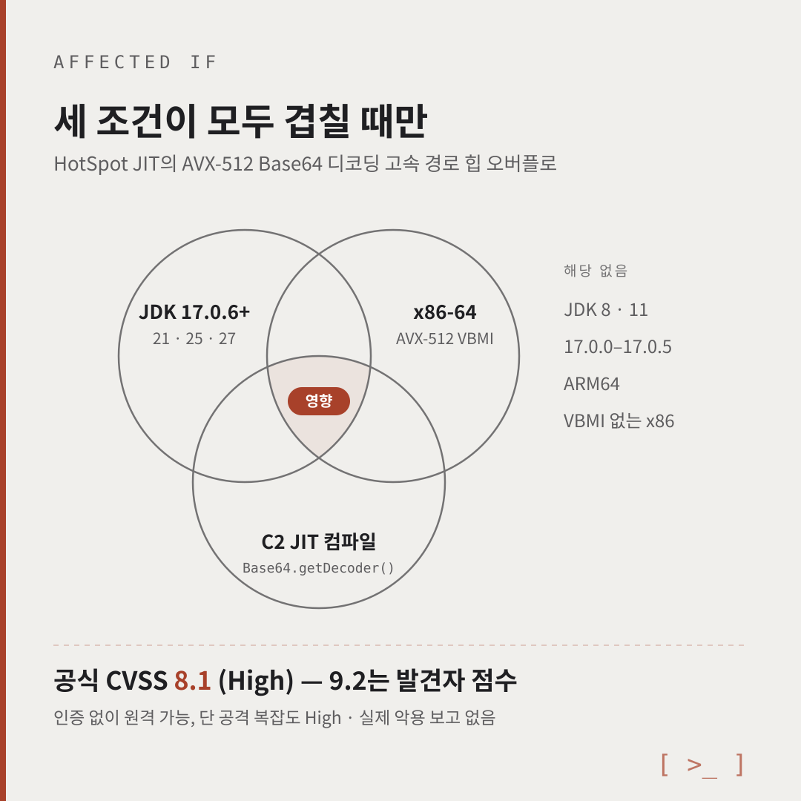
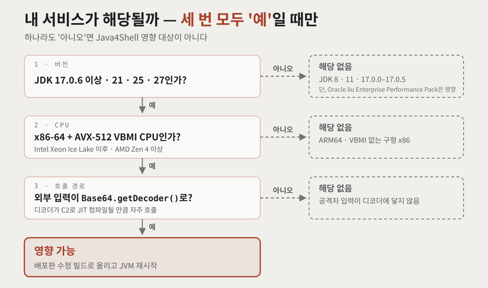

"Base64 쓰는 Java 서비스는 대부분 위험하다"는 말을 보셨다면, 조금 덜어서 들으셔도 됩니다. 11월 17일 공개된 **Java4Shell(CVE-2026-114938)**은 실제로 인증 없이 메모리 손상을 일으킬 수 있는 버그입니다. 다만 특정 JDK 버전과 특정 CPU가 겹쳐야 터집니다.

공유용으로 핵심만 정리했습니다. 내 서비스가 해당되는지 먼저 확인하고 싶다면 '영향 범위' 표부터 보셔도 됩니다.

> **한 줄 요약** — HotSpot JIT의 x86-64 AVX-512 Base64 디코딩 고속 경로에서 힙 오버플로가 납니다. 공식 점수는 CVSS 3.1 8.1(High)입니다. JDK 17.0.6 이상을 최신 Intel·AMD 서버 CPU에서 돌리는 곳이라면 챙겨야 합니다.

## Java4Shell, 무엇이 문제인가?

버그 위치는 `java.util.Base64`의 Java 코드가 아니라 JIT 컴파일러입니다. OpenJDK 권고는 컴포넌트를 `hotspot/compiler`로, 약점 분류는 CWE-122(힙 기반 버퍼 오버플로)로 적었습니다([OpenJDK 권고](https://openjdk.org/groups/vulnerability/advisories/2026-11-17), [CVE 레코드](https://www.cve.org/CVERecord?id=CVE-2026-114938)).

발견자 Calif의 설명은 이렇습니다([Calif](https://calif.io/java4shell/)). 자주 호출되는 디코더는 JIT가 CPU 전용 어셈블리로 바꿔 빠르게 처리하는데, 이를 고속 경로(intrinsic)라고 합니다. AVX-512 VBMI용 고속 경로가 패딩(`=`)이 잘못 붙은 입력의 마지막 몇 글자를 처리할 때 출력 길이 계산이 0 아래로 내려가고, 그 결과 배열 밖으로 수십 바이트를 씁니다. Java는 그 뒤에 `IllegalArgumentException`으로 입력을 거부하지만, 메모리는 이미 덮어써진 뒤라고 합니다.

이름이 Log4Shell과 비슷하지만 Log4j와는 관계없는 별개 버그입니다. Calif는 앞서 공개한 PHP2Shell에서 따온 이름이라고 밝혔습니다.

## 영향 범위는 어디까지인가?

OpenJDK 권고 매트릭스는 이 CVE를 17, 21, 25, 27 계열에만 표시했습니다. 여기에 Calif가 밝힌 CPU 조건이 더해집니다.

| 구분 | 영향 | 근거 |
|---|---|---|
| JDK 17.0.6 이상, 21, 25, 27 + AVX-512 VBMI CPU | 영향 있음 | OpenJDK·Oracle(버전), Calif(CPU) |
| JDK 17.0.0–17.0.5 | 해당 없음 | Calif·Endor 분석 |
| JDK 8, 11 | 해당 없음 (단, Oracle 8u Enterprise Performance Pack 빌드는 영향) | OpenJDK·Oracle·Red Hat |
| ARM64 (Graviton, Apple Silicon) | 해당 없음 | Calif·Red Hat |
| AVX-512 VBMI 없는 x86 (Skylake-SP, Cascade Lake, Zen 3 이하) | 해당 없음 | Calif |

Calif에 따르면 AVX-512 VBMI를 지원하는 CPU는 Intel Xeon Ice Lake 이후 세대와 AMD Zen 4 이상입니다. 여기에 디코더가 C2로 JIT 컴파일될 만큼 자주 호출되고, 공격자 입력이 `Base64.getDecoder()`로 들어가야 합니다.

즉, "Base64 쓰는 Java 서비스 대부분"은 과장입니다. 버전, CPU, 호출 경로가 모두 맞아야 하므로 조건은 꽤 좁습니다. 반대로 최신 x86 클라우드 인스턴스에서 JDK 17·21을 돌리는 곳이라면 해당될 가능성이 충분합니다.

## 심각도는 얼마나 되나?

점수가 세 가지로 돌고 있습니다.

- **CVSS 3.1 8.1 (High)** — Oracle, OpenJDK, NVD 공통입니다. 벡터는 `AV:N/AC:H/PR:N/UI:N`으로, 인증 없이 네트워크로 공격할 수 있지만 공격 복잡도(AC)는 High입니다. Oracle 문구도 "Difficult to exploit"입니다([Oracle CSPU](https://www.oracle.com/security-alerts/cspunov2026.html)).
- **CVSS 4.0 9.2 (Critical)** — Calif가 매긴 점수로, 벡터는 공개되지 않았습니다.
- **CVSS 3.0 9.8 (Critical, draft)** — Red Hat 점수입니다. 공격 복잡도를 Low(`AC:L`)로 봤다는 점이 Oracle과 다릅니다. 조건만 맞으면 공격이 쉽다는 해석인데, 아직 초안(draft) 점수입니다([Red Hat](https://access.redhat.com/security/cve/cve-2026-114938)).

악용 현황은 비교적 조용합니다. CISA가 11월 17일 "즉시 패치하라"는 경보를 내긴 했지만([CISA 경보](https://www.cisa.gov/news-events/alerts/2026/11/17/critical-java-vulnerability-requires-immediate-patching)), KEV(실제 악용 취약점 목록)에는 등록되지 않았고, CISA 평가도 Exploitation: none, Automatable: no입니다. 실제 공격 보고도 없습니다.

Calif는 Keycloak, Jira, Jenkins 같은 제품에서 기본 설정으로 인증 전 원격 코드 실행(RCE)을 시연했다고 주장합니다. 하지만 이는 Calif 단독 주장이고, 독립적으로 재현된 적은 없습니다. Endor Labs는 오버플로와 크래시까지만 재현했다고 밝혔고, Calif 스스로도 "범용 익스플로잇은 없다"고 썼습니다.

## 패치는 어디까지 나왔나? (2026-11-18 저녁 기준)

| 배포판 | 상태 |
|---|---|
| Oracle Java SE | 패치 배포 (11월 Critical Security Patch Update) |
| Amazon Corretto | 수정 완료: 17.0.21.1.2, 21.0.13.1.2, 25.0.5.1.2, 27.0.1.1.4 |
| Eclipse Temurin | 아직 미배포 (최신 빌드가 10월 빌드) |
| Debian | unstable(sid)만 수정, stable(bookworm·trixie)은 아직 vulnerable |
| Red Hat | 영향 패키지 공개(RHEL java-17/21/25-openjdk 등), 수정 릴리스는 아직 없음 |
| Ubuntu | CVE 페이지 공개, 패키지는 아직 분류 중(needs-triage) |

컨테이너 베이스 이미지는 대개 이 배포판들을 따르므로, 이미지 쪽 반영은 며칠 더 걸릴 수 있습니다.

## 같은 날 나온 다른 4건 — 8·11은 이쪽 때문에 업데이트가 필요합니다

"권고가 다섯 건으로 늘었다"는 말도 돌고 있는데, 권고가 확대된 것은 아닙니다. CVE-2026-114939–114942는 처음부터 같은 11월 17일 권고에 함께 있던 별개의 CVE이고, Java4Shell과는 관계가 없습니다([OpenJDK 권고](https://openjdk.org/groups/vulnerability/advisories/2026-11-17)).

| CVE | 영역 | CVSS 3.1 | 영향 계열 |
|---|---|---|---|
| 114938 (Java4Shell) | HotSpot JIT, Base64 고속 경로 | 8.1 | 17, 21, 25, 27 |
| 114939 | JGSS(Kerberos) | 7.4 | 8, 11, 17, 21, 25, 27 |
| 114940 | JSSE(TLS) | 7.4 | 8, 11, 17, 21, 25, 27 |
| 114941 | HotSpot JIT, 정수 압축 | 7.0 | 21, 25, 27 |
| 114942 | core-libs, 벡터 마스크 | 7.0 | 21, 25, 27 (17 포함 여부는 이견: OpenJDK 포함, Oracle·NVD 제외) |

즉, Java4Shell에 해당하지 않는다고 11월 업데이트를 건너뛰어도 된다는 뜻은 아닙니다. JGSS·TLS 두 건은 8과 11까지 영향을 주고, Corretto도 이를 고친 8.514.01.1과 11.0.33.1.1을 따로 냈습니다.

## 지금 할 일은?

- `java -version`으로 런타임 버전과 배포판을 확인합니다. x86 서버라면 `grep -o avx512vbmi /proc/cpuinfo`로 CPU 조건도 함께 볼 수 있습니다.
- 쓰는 배포판이 수정 빌드를 내면 JDK 런타임과 컨테이너 베이스 이미지를 올리고 JVM을 재시작합니다. 업스트림 기준 수정 버전은 17.0.21.1, 21.0.13.1, 25.0.5.1, 27.0.1.1입니다.
- JDK 8·11도 같은 11월 업데이트를 적용합니다. Java4Shell과는 별개로 JGSS·TLS 취약점이 고쳐진 빌드입니다.
- 보고된 임시 우회로 JVM 옵션 `-XX:-UseBASE64Intrinsics`가 있습니다. 다만 추가 진단 옵션이 필요한지를 두고 출처 간 이견이 있어, 쓴다면 `-XX:+PrintFlagsFinal`로 실제 적용 여부를 확인하는 편이 안전합니다.

## 마무리하며

이름은 Log4Shell을 떠올리게 하지만, 영향 범위는 훨씬 좁고 조건이 분명한 버그입니다. 버전과 CPU부터 확인하되, 해당 여부와 상관없이 11월 업데이트는 배포판에서 나오는 대로 올리면 됩니다.

## 참고 자료 (공식 출처)

- [OpenJDK Vulnerability Advisory 2026/11/17](https://openjdk.org/groups/vulnerability/advisories/2026-11-17) — 컴포넌트, 영향 계열(17/21/25/27), CVSS 3.1 8.1
- [Oracle Critical Security Patch Update Advisory – November 2026](https://www.oracle.com/security-alerts/cspunov2026.html) — 영향 버전, "Difficult to exploit" 문구, 패치 배포
- [CVE-2026-114938 (CVE.org)](https://www.cve.org/CVERecord?id=CVE-2026-114938) · [NVD](https://nvd.nist.gov/vuln/detail/CVE-2026-114938) — CWE-122, CISA SSVC 평가
- [Amazon Corretto 17 CHANGELOG 17.0.21.1.2](https://github.com/corretto/corretto-17/blob/17.0.21.1.2/CHANGELOG.md) — 수정 빌드
- [Adoptium API — 최신 Temurin 빌드](https://api.adoptium.net/v3/assets/latest/17/hotspot) — 2026-11-18 조회
- [Amazon Corretto 8 릴리스](https://github.com/corretto/corretto-8/releases) · [Corretto 11 릴리스](https://github.com/corretto/corretto-11/releases) — 8.514.01.1, 11.0.33.1.1
- [Debian Security Tracker — CVE-2026-114938](https://security-tracker.debian.org/tracker/CVE-2026-114938) — 2026-11-18 저녁 조회, sid만 fixed
- [Red Hat — CVE-2026-114938](https://access.redhat.com/security/cve/cve-2026-114938) — CVSS 3.0 9.8(draft), 1.8/11 Not affected, 수정 릴리스 대기
- [Ubuntu — CVE-2026-114938](https://ubuntu.com/security/CVE-2026-114938) — needs-triage
- [CISA 경보 — Critical Java Vulnerability Requires Immediate Patching](https://www.cisa.gov/news-events/alerts/2026/11/17/critical-java-vulnerability-requires-immediate-patching) — 2026-11-17
- [CISA KEV 카탈로그](https://www.cisa.gov/known-exploited-vulnerabilities-catalog) — 2026-11-18 저녁 재조회, 미등록
- 발견자·보안업체 분석(주장 확인용): [Calif — Java4Shell](https://calif.io/java4shell/), [Endor Labs](https://www.endorlabs.com/learn/java4shell-unauthenticated-rce-reported-in-openjdk-17-cve-2026-114938), [Qualys](https://blog.qualys.com/vulnerabilities-threat-research/2026/11/17/how-to-find-mitigate-and-patch-the-critical-java4shell-flaw-cve-2026-114938-now), [GeekNews](https://news.hada.io/topic?id=37370)

#Java4Shell #CVE2026114938 #OpenJDK #Java보안 #HotSpot #JIT #Base64 #AVX512 #힙오버플로 #보안패치 #Corretto #Temurin #JDK11
